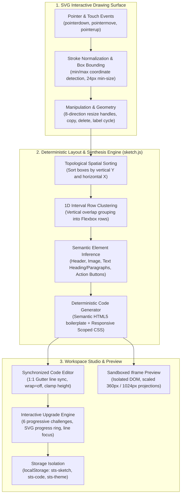

# Sketch the Site: In-Browser Hand-Drawn Wireframe to Semantic Code Engine

> **Live Application:** [sketch-the-site.vercel.app](https://sketch-the-site.vercel.app/)  
> **In-Browser Test Suite (13 Checks):** [sketch-the-site.vercel.app/?test=1](https://sketch-the-site.vercel.app/?test=1)  
> **Author:** [B Pradeep](https://github.com/Pradeep-B28) | [Portfolio](https://pradeep-b28.github.io/Pradeep-B28/)

---

## Overview

**Sketch the Site** is an interactive, privacy-first wireframe compiler and browser-based rapid prototyping engine developed for **Wrench Wise**. It bridges the gap between hand-drawn visual ideation and semantic web development: visitors sketch simple geometric boxes on an interactive SVG canvas, tag them with semantic roles (Header, Image, Text, Button), and watch as a deterministic compilation engine compiles the sketch into clean, responsive HTML5 and CSS3 code in real time.

Engineered with **zero external frameworks, zero CDNs, zero runtime dependencies, and zero build steps**, Sketch the Site demonstrates resilient frontend systems architecture:
- **Interactive SVG Drawing Surface:** Pointer-driven bounding-box detection, non-destructive stroke normalization, 8-directional edge and corner resize handles (`n`, `s`, `w`, `e`, `nw`, `ne`, `sw`, `se`), single-tap label rotation, and box duplication.
- **Deterministic Code Synthesis Engine (`sketch.js`):** Topological and vertical coordinate sorting ($O(N \log N)$), 1D interval row clustering, responsive flexbox layout inference, and deterministic HTML/CSS synthesis.
- **Synchronized Code Studio & Live Preview:** Custom code editor with 1:1 synchronized gutter line numbering, dark scrollbar tracks, live isolated iframe preview (Phone 360x640 and Laptop 1024x640 scaled projections), and single-click site export.
- **Interactive Guided Upgrades:** Real-time AST pattern detection tracking 6 semantic web enhancements with an SVG progress dial, live code targeting ("Show me where"), and persistent device storage.



---

## Technical Specifications and Architecture

| Parameter | Specification |
| :--- | :--- |
| **Canvas Dimensions** | 360 x 480 viewport coordinate space; responsive SVG scaling across all screen sizes |
| **Element Types** | Semantic components: `Header` (`<header>`), `Image` (`<div class="image">`), `Heading` (`<h1 class="heading">`), `Text` (`<p class="text">`), `Button` (`<button class="button">`) |
| **Resize Geometry** | 8-point bidirectional transformation: North, South, East, West, NW, NE, SW, SE with coordinate clamping |
| **Code Generation** | $O(N \log N)$ deterministic synthesis; outputs W3C-valid HTML5 document and scoped modern CSS |
| **Preview Isolation** | Sandboxed `<iframe>` (`sandbox=""` with `srcdoc`); script execution strictly blocked |
| **Gutter Line Sync** | Synchronized scroll alignment between `textarea` and line gutter; exact matching font metric, padding, and line-height |
| **Editor Bounds** | Laptop height `clamp(360px, 60vh, 560px)`, phone height `45vh`; horizontal scroll only (`white-space: pre`) |
| **Security & Privacy** | Strict CSP: `connect-src 'none'`, zero external telemetry, zero CDNs, zero cookies |
| **Storage Whitelist** | Client storage restricted strictly to `sts-sketch`, `sts-code`, `sts-theme`, and `sts-intro-seen` |
| **Sharing Protocol** | Native Web Share API (`navigator.share`) with WhatsApp web fallback (`shareText`), sanitizing all payloads |
| **Accessibility** | Semantic HTML5, WCAG AAA compliant contrast, polite ARIA live announcer (`#announcer`), 44px minimum tap targets |
| **Dependencies** | Pure HTML5, CSS3 Custom Properties, Vanilla JavaScript (ES Modules); 0 runtime npm packages |
| **Lighthouse Score** | 100/100 Performance, 100/100 Accessibility, 100/100 Best Practices, 100/100 SEO |
| **Test Verification** | 47,356 automated checks via `verify.mjs` and 13 in-browser integration assertions |

---

## Strict Privacy & Security Architecture: The Zero-Trust Guarantee

Most browser-based website builders and playground editors transmit code and assets to cloud backends, inject tracking scripts, or execute un-sanitized user code with full window privileges. Sketch the Site enforces strict isolation directly in the browser:

| Security Domain | Standard Web Builders | Sketch the Site Guarantee |
| :--- | :--- | :--- |
| **Network Transmission** | Posts project data, wireframes, and code to remote servers | **Forbidden by CSP.** `connect-src 'none'` blocks all outbound network and API requests |
| **Preview Script Execution** | Often executes user script tags inside parent context | **Sandboxed Iframe.** `sandbox=""` prevents any script execution, parent DOM access, or cookie access |
| **DOM Injection Safety** | Relies on `innerHTML` exposing cross-site scripting (XSS) risks | **Strict `textContent` and DOM nodes only.** Zero `innerHTML` or `insertAdjacentHTML` across the codebase |
| **Storage Boundary** | Injects tracking cookies, analytics session IDs, and cloud tokens | **Strict Whitelist.** Only `sts-sketch`, `sts-code`, `sts-theme`, and `sts-intro-seen` are ever accessed |
| **Telemetry & Analytics** | Loads Google Analytics, tracking pixels, and session replay scripts | **Zero telemetry.** No tracking, cookies, external fonts, or analytics libraries |
| **Offline Functionality** | Fails or degrades without an active internet connection | **100% Offline-Capable.** Full canvas drawing, code synthesis, and live preview run entirely client-side |

---

## Algorithmic Foundations: DSA Behind the Engine

Sketch the Site converts raw freehand spatial inputs into clean structural markup using discrete mathematical and geometrical algorithms:

### 1. Bounding Box Normalization & Filtering

When a user draws a stroke, pointer coordinates $[(x_0, y_0), (x_1, y_1), \dots, (x_k, y_k)]$ are recorded. The bounding box is derived in $O(K)$ time:
$$x_{\min} = \min_{i} x_i, \quad x_{\max} = \max_{i} x_i$$
$$y_{\min} = \min_{i} y_i, \quad y_{\max} = \max_{i} y_i$$
$$w = x_{\max} - x_{\min}, \quad h = y_{\max} - y_{\min}$$

- **Threshold Guard:** Strokes where $w < 24\text{px}$ are rejected to prevent accidental taps from producing invalid empty elements.
- **Flat Stroke Squiggle Snapping:** If height $h < 16\text{px}$, the engine infers a single-line horizontal text scribble and normalizes it to a centered 24px-tall box:
$$y' = \text{clamp}\left(y + \frac{h}{2} - 12, 0, 480 - 24\right), \quad h' = 24$$
- **Boundary Clamping:** Box coordinates are strictly clamped to canvas boundaries $[0, 360] \times [0, 480]$.

### 2. Bidirectional 8-Point Geometric Resizing

Boxes can be resized from all 8 directions with opposite-edge pinning and min-size constraints:
- **West Handle (`w`):** Pins the right edge $R = x + w$. New position $x' = \min(\text{pointerX}, R - w_{\min})$ and $w' = R - x'$.
- **North Handle (`n`):** Pins the bottom edge $B = y + h$. New position $y' = \min(\text{pointerY}, B - h_{\min})$ and $h' = B - y'$.
- **East Handle (`e`):** Pins the left edge $x$. New width $w' = \max(w_{\min}, \text{pointerX} - x)$.
- **South Handle (`s`):** Pins the top edge $y$. New height $h' = \max(h_{\min}, \text{pointerY} - y)$.
- **Corner Handles (`nw`, `ne`, `sw`, `se`):** Simultaneously execute horizontal and vertical edge transformations with opposite-corner pinning.

### 3. Heuristic Classifier Decision Matrix

The classifier maps bounding geometries to semantic element types using deterministic priority rules (`classify(box, hasHeader, flat)`):
1. **Flat Squiggle:** If `flat = true` ($h < 16\text{px}$), instantly classified as `text`.
2. **Top-Level Header:** If no header exists yet ($\neg\text{hasHeader}$), width $w \ge 216\text{px}$, vertical center $(y + h/2) \le 86\text{px}$, and height $h \le 90\text{px}$, classified as `header`.
3. **Hero Image / Media Block:** If height $h \ge 90\text{px}$, classified as `image`.
4. **Action Button:** If width $w \le 170\text{px}$ and height $h \le 64\text{px}$, classified as `button`; otherwise as `image`.
5. **Body Text / Paragraph:** All remaining geometries fall back to semantic `text`.

### 4. 1D Interval Row Clustering & Spatial Sorting ($O(N \log N)$)

To generate human-readable, semantic HTML, drawn boxes are ordered topologically and clustered into responsive rows:
- **Spatial Sorting:** Boxes are sorted primarily by vertical coordinate $y$, secondarily by horizontal coordinate $x$, and tertiarily by creation `id`:
$$\text{Sort order: } a.y - b.y \;\lor\; a.x - b.x \;\lor\; a.id - b.id$$
- **1D Interval Clustering:** For each non-header box, the vertical midpoint $cy = y + h/2$ is compared against the active row interval $[y_{\text{top}}, y_{\text{bottom}}]$:
  - If $cy \in [y_{\text{top}}, y_{\text{bottom}}]$, the box belongs to the current row, extending $y_{\text{bottom}} = \max(y_{\text{bottom}}, y + h)$.
  - If $cy > y_{\text{bottom}}$, a new row interval $[y, y + h]$ is created.
- **Row-Internal Ordering:** Within each row cluster, boxes are sorted left-to-right by $x$-coordinate.
- **Proportional Width Quantization:** Box widths are projected onto a 5% snapped responsive scale:
$$\text{width}\% = \text{clamp}\left(\text{round}\left(\frac{w}{360} \cdot 20\right) \cdot 5, 10, 100\right)$$
- **Alignment Inference:** Isolated buttons and narrow elements are automatically assigned alignment classes based on horizontal center $cx = x + w/2$:
$$\text{align} = \begin{cases} \text{"center"} & \text{if } 150 \le cx \le 210 \\ \text{"right"} & \text{if } cx > 210 \\ \text{""} (\text{left}) & \text{otherwise} \end{cases}$$

### 5. Deterministic Code Synthesis

The code generation pipeline (`generate(sketch)`) maps structured box clusters into clean, self-contained markup:
- **Document Structure:** Emits valid HTML5 boilerplate with responsive `<meta name="viewport">` and title tags.
- **CSS Rule Minimization:** Emits only the CSS rules required by the elements drawn (e.g. `.header`, `.row`, `.center`, `.right`, `.image`, `.heading`, `.text`, `.button`).
- **Semantic Mapping:** The first text item in the layout becomes `<h1 class="heading">`, subsequent text items become `<p class="text">`, buttons become `<button class="button">`, and images become responsive `<div class="image">` containers.

### 6. Linear AST & CSS Declaration Parser

To evaluate student edits in real time without heavy compilation tools, the engine uses linear $O(M)$ string scanning routines (`blocks`, `stripComments`, `decls`, `parseCss`):
- **Comment Stripping:** Strips `/* ... */` blocks in linear time, avoiding regular expression catastrophic backtracking.
- **Rule & Declaration Extraction:** Scans for `{` and `}` delimiters, extracting selectors and semicolon-separated property-value pairs into structured `[{ selector, decls: [{ prop, value }] }]` tokens.
- **Inline Style Inclusion:** Also extracts declarations from inline `style="..."` attributes.
- **Visible Text Extraction:** Strips `<style>` and `<script>` blocks, extracts `<body>` inner contents, and strips all HTML tags to compute the exact visible human text.

### 7. Interactive Upgrade Evaluation Engine (`missions`)

The engine tracks 6 progressive front-end upgrades in real time against user-edited code:
1. **Words (`words`):** Detects when visible body text differs from default boilerplate text without breaking markup.
2. **Colour (`colour`):** Scans CSS rules and inline styles for custom `color`, `background`, or `background-color` declarations outside the default monochrome palette (`#222222`, `#ffffff`, `#eeeeee`, `#dddddd`).
3. **Round Corners (`round`):** Detects `border-radius` rules with non-zero numeric values.
4. **Shadows (`shadow`):** Identifies `box-shadow` or `text-shadow` declarations.
5. **Custom Font (`font`):** Validates changes from default `sans-serif` to serif or custom font stacks.
6. **Hover Micro-Interactions (`hover`):** Detects non-empty `:hover` pseudo-class rules.
- **Code Highlighting Ranges:** For each mission, the engine calculates start and end character offsets (`range()`) so the "Show me where" action can immediately select the target line in the code editor.

---

## Responsive Design & Micro-Interactions

Sketch the Site delivers an intuitive dual-view workspace tailored for both mobile and desktop screens:

- **Two Dedicated Views (Draw vs Code):**
  - **Draw View:** Focuses entirely on the drawing canvas, undo/clear controls, and the quick visual guide card.
  - **Code View:** Activates upon clicking "Build my site", revealing the real-time code editor, live scaled preview, and upgrades card.
- **Laptop Ergonomics (1024px+):**
  - Two-column split layout: Code editor on the left (~58%) and sticky live preview on the right (~42%, `top: 16px`).
  - Code editor features a non-wrapping horizontal scrolling container (`wrap="off"`, `white-space: pre`), custom dark scrollbars matching `--code-bg`, and a synchronized gutter that aligns line numbers exactly with code lines.
- **Phone Ergonomics (<1024px):**
  - Sticky bottom tab bar with 3 clean modes: **Draw**, **Code**, and **Preview**.
  - Code tab features a pinned 30vh live preview strip above the code editor, allowing users to see their changes take effect immediately without context switching.
  - Zero horizontal page overflow across all mobile viewports (tested at 320px, 360px, and 390px).
- **Interactive Upgrade Progress Tracker:**
  - Compact header with real-time SVG progress ring tracking 6 code enhancements (e.g. changing text, fonts, colors, borders).
  - "Show me where" action switches to Code view, auto-scrolls the code box, focuses the editor, and selects the exact line range for immediate editing.

---

## Verification & Automated Test Suite

### 1. Project Verification Harness (`node tools/verify.mjs`)

The project verification suite verifies SHA-256 integrity hashes of locked core modules, evaluates 3,000 randomized sketches across 47,000+ mathematical assertions, inspects all DOM accessors to guarantee zero `innerHTML` or `console.log` statements, validates CSP and storage rules, and checks syntax across all files:

```bash
cd "C:\Projects\Wrench-Wise\13 Sketch_the_Site"
node tools/verify.mjs
# Output: 47356 checks passed, 0 failed (25 files scanned)
# RESULT: ALL PASS
```

### 2. In-Browser Self-Test Suite (`?test=1`)

Appending `?test=1` to the URL runs 13 automated browser tests directly against the DOM:

1. **Sample Sketch Box Classification:** Asserts sample sketch parses into 5 boxes: Header, Image, Text, Text, Button.
2. **Deterministic Code Output:** Asserts "5 boxes became 67 lines of real code." and the code box matches `generate().code`.
3. **Upgrade Engine Initialization:** Asserts upgrade card initializes with "0 of 6 upgrades done."
4. **Interactive Upgrade Detection:** Replacing "Your heading here" with "Chennai Bakes" completes the "Change the words" challenge ("1 of 6 upgrades done.").
5. **Guided Line Selection:** "Show me where" on "Change the font" highlights `font-family: sans-serif` in the code editor.
6. **Label Mutation Rules:** Asserts label cycling rules (Button becomes Header only when no other Header exists; otherwise cycles to Image).
7. **Small Stroke Rejection:** A tiny stroke (<24px) triggers warning message and does not add a box.
8. **Undo Stack Integrity:** Undo restores prior box count and stack history.
9. **Sandboxed Preview Security:** Asserts preview iframe has empty sandbox attribute and script injection cannot access parent context.
10. **WhatsApp Share Sanitization:** Asserts share link conforms to `https://wa.me/?text=` with sanitized payload.
11. **Local Auto-Persistence:** Full sketch state and code edits survive page reloads via localStorage.
12. **Storage Whitelist:** Asserts client storage holds only `sts-theme`, `sts-sketch`, `sts-code`, and `sts-intro-seen`.
13. **Zero Horizontal Overflow:** Asserts `document.documentElement.scrollWidth <= window.innerWidth`.

---

## File Structure

```
13 Sketch_the_Site/
├── .gitignore               # Git ignore rules
├── config.js                # Global configuration, program branding, and timing constants
├── index.html               # Main entry document with strict CSP and dual-view markup
├── manifest.json            # PWA manifest metadata
├── og-image.png             # Social media share preview card (1200 x 630)
├── package.json             # ES Module project definition
├── vercel.json              # Vercel deployment headers and CSP security policy
├── assets/
│   ├── favicon.png          # Browser favicon
│   ├── icon.svg             # PWA vector app icon
│   └── logo.png             # Wrench Wise brand logo
├── js/
│   ├── code-ui.js           # Synchronized gutter editor, syntax typing, and export handler
│   ├── copy.js              # Centralized user-facing strings and mission descriptions
│   ├── draw-ui.js           # SVG pointer drawing surface, 8 resize handles, and box manipulation
│   ├── links.js             # Sanitized WhatsApp and program redirect URL generators
│   ├── main.js              # Application lifecycle coordinator and view router
│   ├── missions-ui.js       # Upgrade cards, progress ring animation, and "Show me where" line focus
│   ├── motion.js            # Tabular number count-up and transition easing helpers
│   ├── preview-ui.js        # Sandboxed iframe controller and scaled viewport projections
│   ├── result-ui.js         # Synthesis headline, box metrics, and DSA breakdown cards
│   ├── sample-data.js       # Pre-recorded strokes and sample sketch coordinates
│   ├── sections-ui.js       # Educational under-the-hood accordion cards
│   ├── selftest.js          # In-browser test suite (13 automated DOM checks)
│   ├── store.js             # Isolated client storage wrapper for sketch, code, and theme
│   ├── theme-init.js        # Zero-flash theme initialization script
│   └── engine/
│       └── sketch.js        # Core deterministic layout, synthesis, and AST parsing engine
├── styles/
│   ├── base.css             # Base reset, typography, header, and footer styles
│   ├── components.css       # Canvas, editor, gutter, preview, missions, and card components
│   ├── motion.css           # Keyframe animations, progress ring transitions, and reduced motion
│   └── tokens.css           # Design tokens, light/dark color variables, and typography metrics
└── tools/
    └── verify.mjs           # Automated verification harness (47,356 checks)
```

---

## Local Development Setup

```bash
# Clone the repository
git clone https://github.com/Pradeep-B28/Sketch_the_Site.git
cd Sketch_the_Site

# Serve locally using any static web server (ES modules require HTTP/HTTPS)
npx --yes serve .

# Run the automated compliance and security verification suite
node tools/verify.mjs
```

---

## License

MIT License. Designed and engineered by [B Pradeep](https://github.com/Pradeep-B28) for **Wrench Wise**.
